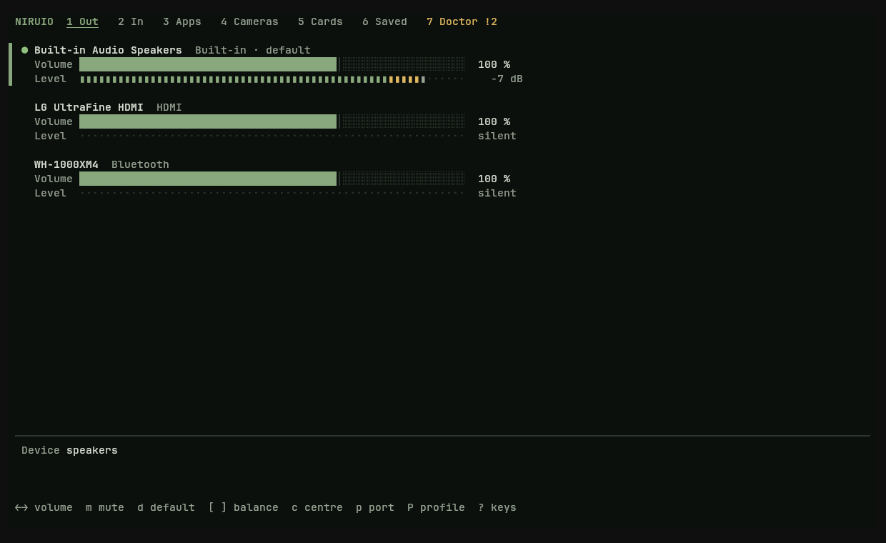

# NIRUIO

Sound in and out, programs, cameras and a sound doctor in one terminal window.

**Status: beta** · Part of the [NIRUX](https://github.com/nirucon/nirux) suite · [MIT License](LICENSE)



## About

NIRUIO ("niru in out") shows everything that makes sound, records sound or
films on a NIRUX machine, and explains silence. It is a keyboard-first
terminal interface (the mouse works too) built on what PipeWire and
WirePlumber already know, so every change it makes is remembered the same way
as a change in any other mixer.

It was written after an evening when every video in mpv played silently: mpv
tags the sound of a video with the role `Movie`, and WirePlumber had
remembered that role as muted. Nothing showed it. NIRUIO shows it on the first
screen of its doctor, together with the fix.

## Features

- **Out and In**: every output and input (built-in, HDMI and DisplayPort, USB,
  Bluetooth) with live level meters, volume or gain up to 150 %, mute,
  left/right balance, the default device, and the port (speaker, headphones,
  line in) and card profile.
- **Microphones**: ALSA microphone boost where the card has one, a five second
  mic test that reports peak, RMS and clipping and plays back only when asked,
  and every input of a multichannel interface (a Behringer UMC1820 has 18)
  with its own meter. Choose which inputs NIRUCLIP records, the same choice as
  `niruclip --mic-channels`.
- **Apps**: which program plays or records, on which device, its level,
  volume and mute, and move it to another output or input.
- **Cameras**: every V4L2 camera, which program has it open, formats and
  sizes, adjustable controls (brightness, exposure, focus, white balance and
  the rest the camera offers), the default camera for NIRUCLIP, and a live
  preview: real pictures in kitty (the graphics protocol), coloured half
  blocks in other terminals. The camera is only opened while the preview is
  on and the tab is showing.
- **Cards**: profiles and ports of every card. Bluetooth headsets switch
  between hi-fi playback (A2DP) and headset mode with microphone (HFP/HSP);
  the codec is shown, and on WirePlumber 0.5 codec choices appear as profiles.
- **Saved**: what WirePlumber remembers per media role and per program
  (volume, mute, device), with the entries that silence something marked.
  Reset one or all of them to 100 % unmuted.
- **Doctor**: why is nothing heard, why is nothing recorded, why is the camera
  missing. It follows the sound from the program's stream to the remembered
  role or program setting, the output or input device, the card profile and
  port, ALSA switches behind PipeWire's back and the device itself, and offers
  one fix per finding.
- A command line for scripts, `nirux doctor` and the launcher:
  `niruio status`, `niruio doctor`, `niruio saved`, `niruio reset`, all with
  `--json` where it makes sense.
- Colours follow the active NIRUX theme, including your own themes.
- Starts in milliseconds; meters run only for the tab you look at and stop
  when you leave it.

Not in NIRUIO: displays (NIRU Display), Bluetooth pairing (NIRU Launcher),
event sounds and Do Not Disturb (NIRUNOTIFY). MIDI devices are planned for a
later version.

## Requirements

- Linux with PipeWire and WirePlumber 0.4 or 0.5 (Debian 12 and 13, Arch,
  Void). The tools NIRUIO calls ship with them: `pw-dump`, `pw-cli`,
  `pw-record`, `pw-play`, `pw-loopback`, `pw-metadata` and `wpctl`.
- Optional: `amixer` (`alsa-utils`) for boost and ALSA switches, `v4l2-ctl`
  (`v4l-utils`) and `ffmpeg` for cameras, kitty for the picture preview.
- A terminal of at least 80x24 cells. Inside NIRUX all of this is installed.

## Installation

### With NIRUX

NIRUIO is a core component: `nirux install` and `nirux update` install and
update it from the pinned manifest. `Super+Shift+A` opens it as a floating
window, and the launcher's Sound view has an "Open NIRUIO" row. The
standalone installer refuses to touch a NIRUX-managed copy.

### Standalone

```sh
git clone https://github.com/nirucon/niruio
cd niruio
./install.sh            # download the pinned release, verify SHA256SUMS, install to ~/.local/bin
./install.sh --build    # or build from this checkout with cargo
```

`NIRUIO_PREFIX` (or `NIRU_PREFIX`) changes the prefix (default `~/.local`).

## Usage

```sh
niruio                    # the interface, on the Out tab
niruio --tab doctor       # on a tab: out, in, apps, cameras, cards, saved, doctor
niruio cameras            # out, in, apps, cameras and cards work without --tab
niruio --window apps      # in its own floating kitty window (what Super+Shift+A runs)
niruio status             # defaults, programs, cameras and the number of problems
niruio status --json
niruio doctor --brief     # the doctor on the command line; exit status 1 on problems
niruio doctor --fix       # apply every fix for problems and warnings
niruio saved              # what WirePlumber remembers
niruio reset --silencing  # reset every remembered entry that mutes or silences
niruio reset 'Output/Audio:media.role:Movie'
```

`status`, `doctor`, `saved` and `reset` are commands; `--tab saved` and
`--tab doctor` open those tabs in the interface.

### Keys

| Key | Action |
|-----|--------|
| `Tab`, `Shift+Tab`, `1`-`7` | switch tab (or click a tab) |
| `↑` `↓`, `j` `k`, `PgUp` `PgDn` | select (or click, wheel) |
| `←` `→`, `h` `l`, `-` `+` | volume or gain 5 % (`Shift`: 1 %), up to 150 %; click a bar to set it |
| `m` | mute or unmute (or right click) |
| `d`, `Enter` | make the default output or input |
| `[` `]`, `c` | balance left, right, centre |
| `p`, `P` | port, card profile |
| `t`, `y` | In: record a 5 s test, play it back |
| `b`, `B` | In: ALSA microphone boost down, up |
| `n` | In: the inputs NIRUCLIP records; Cameras: NIRUCLIP's camera |
| `o`, `Enter` | Apps: move the program to another device |
| `Enter`, `v`, `0` | Cameras: controls, live preview, a control's default |
| `Enter`, `o` | Cards: profile, port |
| `Enter`, `R` | Saved: reset the entry, reset every silencing entry |
| `Enter`, `F`, `r` | Doctor: apply the fix, fix all, check again |
| `?` | all keys |
| `q`, `Esc` | quit |

## How it works

- **Devices and programs** come from `pw-dump --monitor`, so the screen
  follows every change at once without polling.
- **Changes** go through `wpctl` (volume, mute, default), `pw-cli` (balance,
  port and profile, saved with the card) and `pw-metadata` (moving a
  program). WirePlumber stores them like any other change.
- **Meters** are one `pw-record` per shown device or program writing raw
  samples to a pipe. Outputs and programs are metered passively and never
  wake a sleeping device. Measured on a 12-core desktop: about 2 % of one core
  for the interface with two live meters, and nothing when no meter shows.
- **Remembered settings** live in `~/.local/state/wireplumber/` (the
  `stream-properties` file on WirePlumber 0.5, `restore-stream` on 0.4).
  WirePlumber keeps them in memory and writes the file back, so editing the
  file does not work while it runs. A reset briefly creates a silent stream
  with the same key (for example `media.role=Movie`) that is linked only to a
  private null sink, lets WirePlumber apply the remembered values, sets 100 %
  and unmute with `wpctl`, and removes both again. WirePlumber then stores the
  new values itself. Nothing is played and no device is touched.
- **ALSA** controls are read with `amixer`; the doctor only reports a switch
  that is off while PipeWire shows the device on.
- **Cameras** are found in `/sys/class/video4linux`, users through `/proc`
  (programs of other users are not visible), formats and controls through
  `v4l2-ctl`, and the preview is ffmpeg at five frames a second.
- **NIRUCLIP** reads `camera`, `mic` and `mic_channels` from the top of
  `~/.config/niruclip/config.toml`; NIRUIO changes only those lines. A
  NIRUCLIP profile that sets its own value still wins.

## Configuration

None. The theme comes from NIRUWM's `theme` setting.

## Testing

```sh
cargo fmt --check
cargo clippy --locked --all-targets -- -D warnings
cargo test --locked
sh tests/smoke.sh target/release/niruio      # headless, against a fixture graph
sh tests/sandbox.sh target/release/niruio    # a private PipeWire with null sinks only
```

The sandbox test starts its own PipeWire and WirePlumber with every hardware
monitor disabled and their own state directory, so it never touches a sound
card or the session's remembered settings.

## License

MIT, see [LICENSE](LICENSE).
